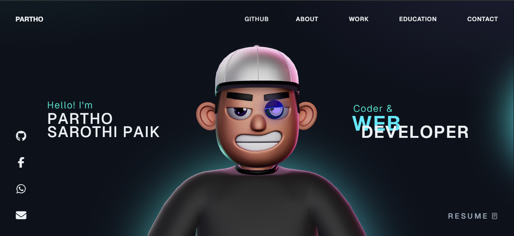

<div align="center">

  

  <br /><br />

  <h1>Interactive 3D Developer Portfolio</h1>

  <p><b>Immersive personal web experience built with Three.js, React Three Fiber, and GSAP</b></p>

  <p>
    An interactive portfolio website showcasing modern web engineering, real-time 3D scenes, physics-based simulations, and smooth scroll-driven animations.
  </p>

  <p>
    <a href="https://parthosarothipaik.netlify.app/"></a>
    <a href="https://react.dev"></a>
    <a href="https://www.typescriptlang.org"></a>
    <a href="https://threejs.org"></a>
    <a href="https://r3f.docs.pmnd.rs"></a>
    <a href="https://gsap.com"></a>
    <a href="LICENSE"></a>
  </p>

  <h3>Live Demo: <a href="https://parthosarothipaik.netlify.app/">https://parthosarothipaik.netlify.app/</a></h3>

</div>

---

## Overview

**Partho's 3D Portfolio** combines cutting-edge WebGL graphics rendering with responsive UI design, integrating custom 3D character avatars, physics engines (Rapier/Cannon), and cinematic camera transitions controlled via GSAP timeline sequences.

Experience the live interactive website at **[https://parthosarothipaik.netlify.app/](https://parthosarothipaik.netlify.app/)**.

All 3D assets are optimized with Draco compression for quick page hydration, providing fluid 60+ FPS navigation on both mobile and desktop screens.

---

## Key Features

- **Real-Time 3D Rendering** — Interactive scenes powered by Three.js and `@react-three/fiber` featuring ambient lighting, custom materials, and shadow maps.
- **Cinematic Scroll Animations** — Timeline-synchronized transitions and camera path movements orchestrated with GreenSock (GSAP).
- **Physics & Character Controller** — Real-time physics simulation using `@react-three/rapier` with collision boundaries and interactive cursor effects.
- **High-Speed Asset Pipeline** — Draco-compressed 3D mesh geometry (`.glb`) and WebP texture compression for fast asset streaming.
- **Cross-Device Performance** — Adaptive pixel ratio scaling and responsive viewport calculation ensuring smooth frame rates on mobile hardware.
- **Modular Component Architecture** — Clean separation of 3D canvas components, HTML overlays, and reactive state stores.

---

## Tech Stack

| Layer | Technology | Purpose |
| :--- | :--- | :--- |
| **UI Framework** | [React 18](https://react.dev) | Reactive component tree & lifecycle management |
| **Language** | [TypeScript 5.5](https://www.typescriptlang.org) | Strict type checking & autocompletion |
| **3D Rendering** | [Three.js](https://threejs.org) & [R3F](https://r3f.docs.pmnd.rs) | WebGL canvas, camera, shaders & scene graph |
| **Scene Utilities** | [@react-three/drei](https://github.com/pmndrs/drei) | Helper abstractions, loaders & environment presets |
| **Physics Simulation** | [@react-three/rapier](https://github.com/pmndrs/react-three-rapier) | Rigid body dynamics & collision detection |
| **Animations** | [GSAP 3](https://gsap.com) | Smooth scroll triggers & micro-interactions |
| **Build Tool** | [Vite 5](https://vite.dev) | Lightning-fast development server & asset bundler |

---

## Getting Started

### Prerequisites
- **Node.js**: `>= 18.x`
- **npm**: `>= 9.x`

### Installation & Development

1. **Clone the repository**:
   ```bash
   git clone https://github.com/CodeByPartho/partho-3d-portfolio.git
   cd partho-3d-portfolio
   ```

2. **Install dependencies**:
   ```bash
   npm install
   ```

3. **Start local development server**:
   ```bash
   npm run dev
   ```
   Open `http://localhost:5173` to explore the 3D scene.

4. **Build for production**:
   ```bash
   npm run build
   ```
   The compiled static assets will be ready in the `dist/` directory.

---

## License

This project is licensed under the **[MIT License](LICENSE)**.

---

<p align="center">Built by Partho</p>
